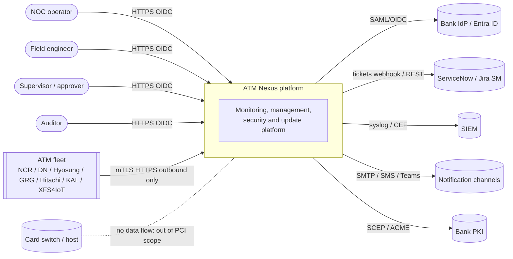
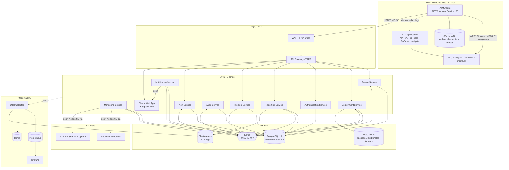
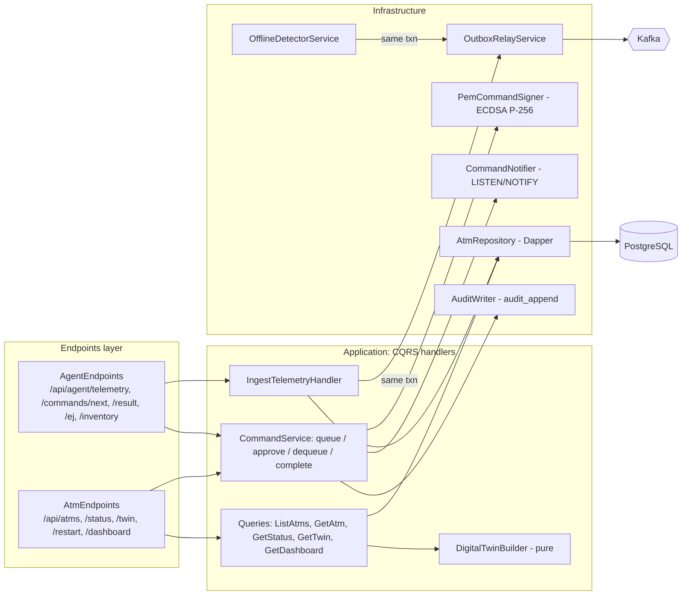
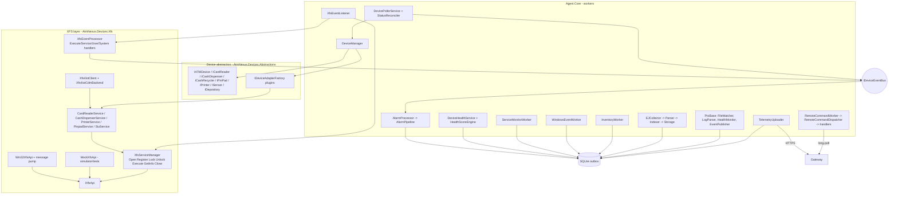
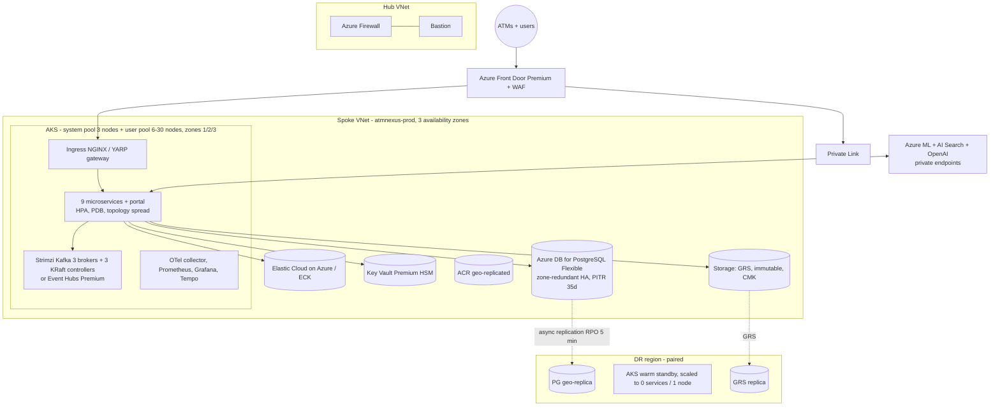
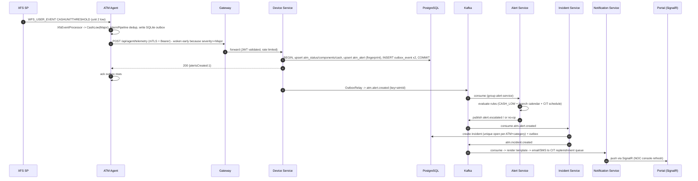
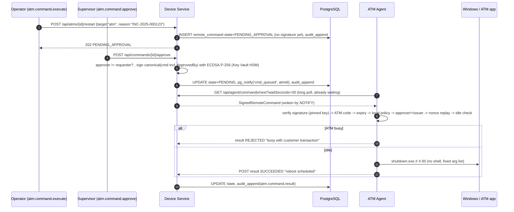
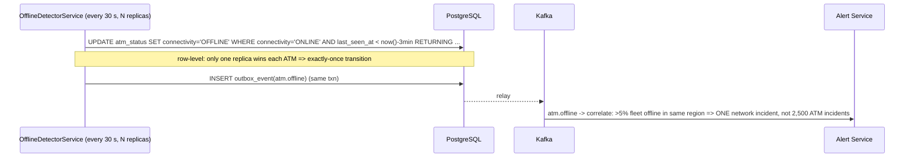
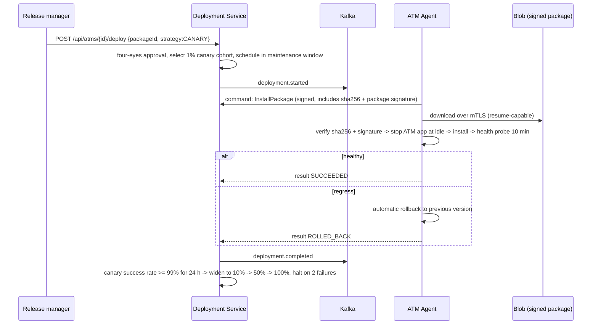
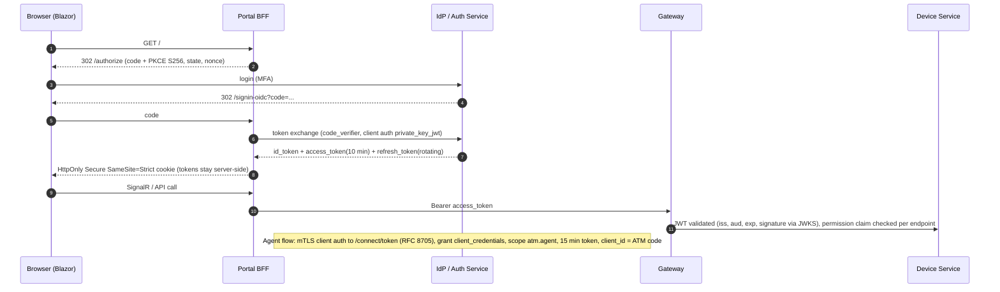

# 01 - System architecture (C4)

Model-as-code: `docs/architecture/workspace.dsl` (Structurizr DSL: `structurizr-cli export -w workspace.dsl -f mermaid`).
The Mermaid below renders on GitHub/Azure DevOps wikis.

## 1. Layers and the contract between them

| # | Layer | Tech | Owns | Talks to (protocol) |
|---|---|---|---|---|
| 1 | **ATM Agent** | .NET 9 Worker Service, win-x86, SQLite WAL cache | Device status, XFS events, EJ, inventory, command execution, store-and-forward | API Gateway (HTTPS, mTLS + OAuth2 client-credentials, **outbound only**) |
| 2 | **API Gateway** | YARP on AKS behind Azure Front Door/App Gateway WAF (on-prem: NGINX/Envoy) | TLS/mTLS termination, JWT pre-validation, rate limiting, routing, request-size limits | Backend services (HTTP/2, mTLS via mesh) |
| 3 | **Backend services** | ASP.NET Core 9 minimal APIs, Clean Architecture + CQRS | Business logic per bounded context (9 services) | PostgreSQL (SQL), Kafka (events), each other only via events |
| 4 | **Database layer** | PostgreSQL 16 (zone-redundant HA), Elasticsearch 8 (EJ + log search), Redis (optional cache) | System of record (PG), search (ES) | - |
| 5 | **Messaging layer** | Apache Kafka (Strimzi / Azure Event Hubs Kafka endpoint / Confluent) | Event backbone, 8 topics + DLQs | Producers: outbox relays; Consumers: services, AI, Notification |
| 6 | **Monitoring layer** | OpenTelemetry Collector, Prometheus, Grafana, Elastic (logs), Tempo (traces) | Platform observability (not ATM monitoring) | OTLP from every service and (optionally) agents |
| 7 | **AI layer** | Azure ML (training, registry, managed online endpoints), Azure AI Search + Azure OpenAI (RCA retrieval), ADLS Gen2 (feature store) | Classification, failure prediction, RCA suggestions | Monitoring service (HTTPS, circuit-broken, rules fallback) |
| 8 | **Notification layer** | Notification service, SignalR hub (UI push), SMTP/SMS/Teams/webhook adapters, ITSM connector | Fan-out with retry + DLQ | Kafka in; adapters out |

**Hard rules** (enforced in review and by `tests`):
1. Agents never accept inbound connections. Everything is pull/push **from** the ATM.
2. Services own their tables. Cross-service reads go through events or APIs, never SQL.
3. State change and its event are written in **one transaction** (outbox); Kafka outage never loses or blocks writes.
4. No cardholder data (PAN, track, PIN, keys) is stored or transmitted unmasked. The agent masks at source (`PanMasker`).
5. Disruptive actions require dual control and a signature that the **ATM itself** verifies.

## 2. Level 1 - System context

## 3. Level 2 - Containers

## 4. Level 3 - Components

### 4.1 Device Service (implemented: `src/Services/AtmNexus.Services.Device`)

### 4.2 ATM Agent (implemented: `src/Agent/*`)

## 5. Deployment diagrams

### 5.1 Azure (reference deployment, 50k ATMs)

### 5.2 Deployment model variants

| Model | Compute | PostgreSQL | Kafka | Object store | Secrets | Notes |
|---|---|---|---|---|---|---|
| **On-premise** | Kubernetes (RKE2/OpenShift), 3 racks/zones | Patroni 3-node (sync replica) + pgBackRest | Strimzi 3+3 | MinIO (erasure-coded) | HashiCorp Vault + CSI | Air-gapped option: mirror registry, no AI layer or on-prem ONNX scoring |
| **Private cloud** | Same Helm charts on tenant K8s | Managed PG or Patroni | Strimzi / Redpanda | S3-compatible | Vault | Same artefacts, only values files differ |
| **Azure** | AKS | Flexible Server ZRS | Event Hubs Kafka or Strimzi | Blob (GRS) | Key Vault | Reference above |
| **Hybrid** | Data plane on-prem (PG, Kafka, ES, gateway in DMZ); optional control/analytics plane in Azure | On-prem | On-prem Kafka + MirrorMaker 2 -> Event Hubs for AI | Both | Vault + Key Vault | ATMs only ever reach the on-prem gateway; only **de-identified** features leave the bank network |

## 6. Sequence diagrams

### 6.1 Telemetry -> alert -> incident -> notification

### 6.2 Remote restart with dual control (reboot) and local verification

### 6.3 Heartbeat loss -> offline

### 6.4 Software deployment (canary)

### 6.5 Authentication

## 7. Capacity model (50,000 ATMs)

| Quantity | Calculation | Result |
|---|---|---|
| Telemetry messages | 50,000 / 60 s | **~833/s** steady, ~2,500/s peak after a network outage (agents jitter retries; backlog drains from SQLite) |
| Message size | 5 devices + 4 cassettes + <=10 events | 3-6 KB -> 2.5-5 MB/s ingress |
| Long-poll connections | 1 per ATM | 50,000 held open: 6 pods x ~8,000 (Kestrel handles >50k per pod; spread for failure domains) |
| PG write TPS | status upsert + components + cash + (alerts) | ~833 txn/s x ~12 statements = 10k stmt/s - fits a 16 vCPU Flexible Server; hot rows use fillfactor 70-80 for HOT updates |
| `atm_status_history` rows | sampled: level change or 1 per 15 min | 50k x 96/day = **4.8M/day**, ~430M rows / 90 days, partitioned monthly (unsampled would be 72M/day) |
| Kafka partitions | per-ATM ordering by key; consumers scale to partitions | `atm.status.changed` 48, `atm.alert.created` 48, `atm.ej.batch` 96 |
| EJ volume | ~150 tx/ATM/day x 50k x ~1.2 KB indexed | 9 M docs/day ~ 11 GB/day raw (3-4 GB compressed), ILM hot 30d -> warm -> snapshot |
| Service replicas | Device 6-12, others 2-6 | HPA on CPU 65% |

## 8. Availability design (99.99% = 52.6 min/year)

| Failure | Mitigation | Customer-visible effect |
|---|---|---|
| Pod / node loss | >=3 replicas, zone spread, PDB minAvailable 2, readiness gating, `maxUnavailable: 0` | none |
| AZ loss | 3-zone AKS, PG zone-redundant HA (sync standby, failover ~60-120 s), Kafka RF3 minISR2 | in-flight requests retried by agents |
| PostgreSQL failover | Npgsql retry on transient, outbox + agents buffer, `Maximum Pool Size` tuned | ingest pauses <=2 min, no data loss |
| Kafka outage | Outbox keeps writing; relay resumes in order | alerts/incidents delayed, ingest unaffected |
| Platform outage | **Agent keeps monitoring and queueing (50k rows = days); ATMs keep serving customers** - the agent is never on the transaction path | none for cardholders |
| Region loss | Warm standby in paired region; PG async replica RPO <=5 min, RTO <=30 min (runbook + quarterly drill); agents fail over via DNS/Front Door | NOC degraded ~30 min |
| Bad release | Canary + `helm --atomic` + SLO burn gate + one-command rollback; DB migrations expand/contract | none |
| Poison message | Retry 3x with backoff -> `dlq.<group>`; alert on DLQ depth | one event delayed |
| Thundering herd after outage | Agent jitter (+/-20%), exponential backoff to 15 min, token-bucket rate limit per client | smoothed ingest |

Error budget: 4.3 min/month. Burn-rate alerts (14.4x/5 min page, 6x/30 min page, 1x/6 h ticket) are in `deployment/observability/prometheus-rules.yaml`.

## 9. Technology decisions (ADR summary)

| ID | Decision | Alternatives | Why |
|---|---|---|---|
| ADR-1 | Agent is **x86**, .NET 9 self-contained single file | x64, .NET Framework 4.8 | msxfs.dll is 32-bit on nearly all ATMs; .NET 9 gives a modern runtime without GAC/installer dependencies |
| ADR-2 | Pull model + outbound HTTPS only | MQTT/gRPC streaming, inbound agent port | Bank firewalls allow outbound 443 only; long-poll reaches the same latency with no inbound surface |
| ADR-3 | Dapper + hand-written SQL on hot paths | EF Core everywhere | Explicit upserts/`SKIP LOCKED`/`LISTEN`; predictable plans at 10k stmt/s. EF Core remains fine for admin CRUD services |
| ADR-4 | Transactional outbox | Dual write, CDC (Debezium) | Simple, portable to on-prem; Debezium is the migration path if relay becomes a bottleneck |
| ADR-5 | Postgres LISTEN/NOTIFY for command wake-up | Redis pub/sub, SignalR to agents | No extra infrastructure; falls back to timed re-check if the LISTEN connection drops |
| ADR-6 | Signed commands verified **on the ATM** | Trust the TLS channel only | Compromise of the gateway/API cannot execute anything on 50k ATMs |
| ADR-7 | Health score computed on the ATM **and** re-derivable server-side | Server only | Works while offline, deterministic, same code in both places |
| ADR-8 | Vendor differences are **data** (profiles: status layouts, event catalog, SIU maps, EJ regex) | Per-vendor code branches | Onboarding a new ATM model = capture logs + edit JSON, not a release |
| ADR-9 | Blazor Web App (Interactive Server for NOC, WASM for admin) | React SPA | One language/team; SignalR push built in |
| ADR-10 | Kafka event backbone, JSON + schema registry (BACKWARD compat) | Avro/Protobuf | JSON is debuggable by NOC engineers; schemas still enforced centrally |
