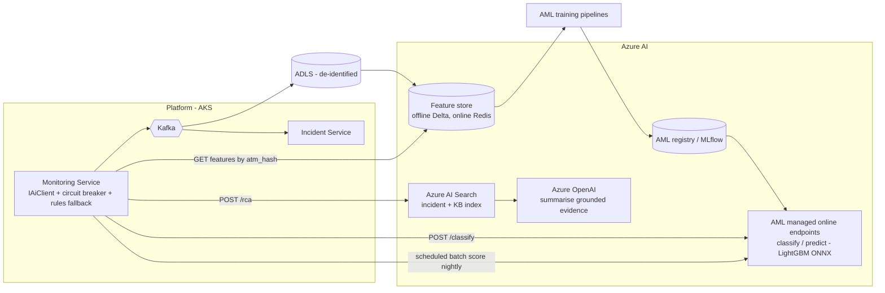

# 11 - AI implementation

Status **[D]** (Phase 3). The data contracts it depends on are implemented: event stream (`docs/05-events-kafka.md`), digital twin (`DigitalTwinBuilder`), health history (`atm_status_history`), EJ (`atm-ej-*`), incident resolution codes (`atm_incident.resolution_code`).

Principle: **AI advises, rules decide, humans approve.** Every AI output is optional input to a rule or a person; if the AI layer is down the platform behaves exactly as in Phase 1/2 (circuit breaker + rules fallback). No cardholder data enters the AI layer (features are device/telemetry/incident derived; EJ contributes only counts and error codes).

## 1. Three features at a glance

| Feature | Question answered | Output | Consumer |
|---|---|---|---|
| **Incident classification** | What kind of incident is this and who should get it? | `category`, `priority`, `assignedGroup`, confidence | Incident Service (pre-fills; auto-route above threshold) |
| **Failure prediction** | Will this ATM/component fail in the next 7 days? | per-component risk (0-1), top contributing features, recommended action | Monitoring Service -> `atm.prediction.created` -> Alert/Incident (proactive ticket), Dashboard "at-risk" tile |
| **Root-cause suggestions** | Why did this happen and what fixed it before? | ranked causes with evidence, similar past incidents, suggested runbook steps/commands | Incident detail "Suggestions" panel (human selects) |

## 2. Training data sources

| Source | Content | Volume (50k ATMs) | Use |
|---|---|---|---|
| `atm_status_history` | health score/level time series (sampled 15 min) | 4.8 M rows/day | trend features, labels (Critical/Down episodes) |
| `atm_alert` (+ event stream) | alert code, severity, source, unit, timestamps, occurrences | ~1-3 M/day | sequence features, classification text/structure |
| `atm_incident` | category, priority, group, resolution code, notes, MTTR | ~15-30 k/day fleet-wide | **labels** for classification + failure ground truth ("hardware incident within 7 d") |
| `atm_component` / `atm_cash_unit` | state, attributes, firmware, counters | snapshots | static + slowly varying features |
| Agent `metrics` | `xfs_errors` rate, device retry counters, read error rates, temperature, uptime, reboot count | per telemetry | degradation signals |
| EJ aggregates | transactions/h, failure/timeout/cancel rate, error codes (counts only) | derived hourly | demand and error-pattern features |
| Inventory | OS build, patch age, app/agent version, SP versions | daily | cohort/regression features |
| Field notes | technician resolution text (PII-scrubbed) | text | RCA retrieval corpus |

Landing: Kafka -> Event Hubs capture / Kafka Connect -> **ADLS Gen2** (Delta/Parquet, partitioned by `date`, `vendor`), de-identified: ATM ids are salted-hashed in the analytics zone; no PAN anywhere. Retention: 25 months for seasonality.

## 3. Feature engineering

Computed in Databricks/Synapse Spark (batch, daily + hourly incremental) into an **offline feature store** (Delta) and materialised to the **online store** (Redis/Azure Cosmos DB) for low-latency scoring; the same transformation code is shared (PySpark UDFs / feature definitions) to avoid train/serve skew.

| Group | Features (examples) |
|---|---|
| Component degradation | 7/14/30-day counts of `CARD_JAM`, `CASH_LOW`, `HARDWARE_ERROR` per device; dispense reject rate; retries per 1,000 `WFSExecute`; card read error ratio; paper-jam rate; mean time since last reset; **trend slope** of `xfs_errors` (linear fit over 14 d); EWMA of error rate |
| Cash | burn rate per denomination (notes/day, weekday-adjusted), days-to-empty estimate, replenishment gap, % time with any cassette Low |
| Health | mean/min health score 7 d, number of level transitions, minutes in Degraded/Critical, component sub-scores |
| Environment | temperature p95, vibration events, door-open events, power/uptime resets |
| Software | OS patch age, agent/app/SP versions, version == cohort mode?, days since last deployment, last deployment result |
| Peers | z-score of own error rate vs same model+firmware+branch-type cohort |
| Calendar | day-of-week/hour, month-end, payday proximity, public holiday |
| Static | vendor, model, age (install date), branch type, region |
| Text (classification/RCA) | alert code/source tokens, device class, health reasons string, embedding of title/description (Azure OpenAI `text-embedding-3-large`) |

Leakage guards: features strictly use data **before** the prediction timestamp; labels use a 7-day forward window; train/validation split by **time** (never random) and additionally by ATM for generalisation checks.

## 4. Model selection

| Feature | Model | Why | Metric / acceptance |
|---|---|---|---|
| Incident classification | **LightGBM** multi-class on structured features + sparse text (TF-IDF) as baseline; upgrade path: fine-tuned **Azure AI Language custom text classification** / small transformer when notes are rich | Tabular + short text: GBMs are accurate, fast, explainable (SHAP), cheap | macro-F1 >= 0.85, top-2 accuracy >= 0.95, per-class recall >= 0.8 for Security; confidence threshold 0.85 for auto-route |
| Failure prediction | **Gradient-boosted trees (LightGBM/XGBoost)** per component family (dispenser, card reader, printer/EPP) with class weights; **survival model** (Cox / RSF) for time-to-failure as the second opinion; start with **Azure ML AutoML** to benchmark | rare-event, tabular, interpretable; per-family models respect different failure physics | PR-AUC (not ROC-AUC: ~1-2% positives), precision@top-1% >= 40% with >= 5 days median lead time; calibration (Brier) |
| RCA suggestions | **Hybrid**: (1) deterministic causal rules from the vendor knowledge base (e.g. `CARD_JAM` after `fallback` reads -> check skimmer/bezel), (2) **retrieval** over resolved incidents (Azure AI Search vector + BM25 hybrid, filter by vendor/model/code), (3) **LLM summariser** (Azure OpenAI GPT-4-class) grounded **only** on retrieved evidence, citation-required, JSON output | Explainable and auditable; no free-form hallucinated fixes; LLM adds wording, not facts | human acceptance rate >= 60%, "helpful" feedback >= 70%, zero uncited suggestions |

Training pipeline: Azure ML pipelines (components: extract -> features -> train -> evaluate -> register), MLflow tracking, model registry with stage gates (Staging -> Production requires: metrics above, bias/segment checks per vendor/model/region, approval by data owner), monthly retrain + drift-triggered retrain.

## 5. Inference architecture



* **Online** (low latency, per event): classification on `atm.alert.created`/`atm.incident.created` (p95 < 300 ms, endpoint autoscaled 1-10, ONNX-exported LightGBM). Failure prediction is **batch + hourly incremental** (scores 50k ATMs in minutes) - near-real-time adds no value for 7-day horizons.
* **Fallback**: `IAiClient` wraps calls in Polly (timeout 800 ms, retry 1, circuit breaker 5 failures/30 s). On failure: classification falls back to the **rule table** (alert code -> category/priority); predictions simply aren't refreshed (stale flag on dashboard); RCA panel hides. `atmnexus_ai_fallback_total` tracks it.
* **Security**: private endpoints/VNet integration, managed identity (no keys), Azure OpenAI with data-logging opt-out and content filters, prompts built from templates (no user free text injected raw), output validated against a JSON schema, PII scrubber before indexing field notes.
* **Governance**: model card per model (data, metrics, limits), prediction audit (inputs hash, model version, score) in `atm_prediction`, human feedback loop (`POST /api/ai/feedback`) feeds labels and acceptance KPIs; kill-switch feature flag per feature.

## 6. API integration

AI is behind the Monitoring Service so no other service depends on Azure.

```yaml
# Monitoring Service -> Azure ML online endpoint (internal contract)
POST /classify
{ "alert": { "code": "CARD_JAM", "severity": "Critical", "source": "IDC30", "data": { "deviceClass": "CardReader" } },
  "atm": { "vendor": "DN", "model": "DN Series 200", "branchType": "OFFSITE", "firmware": "1.8.0" },
  "context": { "healthScore": 38, "alerts24h": 3, "recentCommands": ["RestartDevice"] },
  "text": "Card jammed in reader" }
-> { "category": "HARDWARE", "priority": "P2", "assignedGroup": "FIELD-SOUTH-ATM", "confidence": 0.91,
     "alternatives": [ { "category": "SECURITY", "confidence": 0.06 } ], "modelVersion": "incident-clf:7" }

POST /predict            # batch: array of atm feature rows from the online feature store
-> [ { "atmCode": "ATM-000124", "component": "CardReader", "riskScore": 0.74, "horizonDays": 7,
       "topFeatures": [ { "name": "card_jam_14d", "value": 5, "contribution": 0.31 }, { "name": "retry_rate_slope", "value": 0.8, "contribution": 0.22 } ],
       "recommendation": "Schedule preventive replacement of card reader at next CIT visit", "modelVersion": "failure-reader:12" } ]

POST /rca
{ "incidentId": "...", "atmCode": "ATM-000124", "alertCodes": ["CARD_JAM","TECHNICAL_FALLBACK"], "vendor": "DN", "model": "DN Series 200" }
-> { "suggestions": [ { "cause": "Card skimmer / bezel obstruction",
                         "evidence": [ { "incident": "INC-2024-004211", "resolution": "Foreign device removed", "similarity": 0.88 } ],
                         "steps": [ "Dispatch field engineer with bezel inspection checklist", "Collect EJ for last 24 h (CollectEj)" ],
                         "confidence": 0.72 } ], "citations": ["INC-2024-004211"] }
```
Platform-side C# (Monitoring Service):

```csharp
public interface IAiClient
{
    Task<ClassificationResult?> ClassifyAsync(AlertContext ctx, CancellationToken ct);
    Task<IReadOnlyList<Prediction>> PredictAsync(IReadOnlyList<AtmFeatures> rows, CancellationToken ct);
    Task<RcaResult?> SuggestRootCauseAsync(RcaRequest req, CancellationToken ct);
}

// Resilient wrapper: AI failure never blocks incident creation
public sealed class ResilientAiClient(IAiClient inner, IRuleClassifier rules, ILogger<ResilientAiClient> log) : IAiClient
{
    public async Task<ClassificationResult?> ClassifyAsync(AlertContext ctx, CancellationToken ct)
    {
        try { return await inner.ClassifyAsync(ctx, ct) ?? rules.Classify(ctx); }
        catch (Exception ex) when (ex is HttpRequestException or TimeoutRejectedException or BrokenCircuitException)
        {
            AiMetrics.Fallback.Add(1, new("feature", "classify"));
            return rules.Classify(ctx);
        }
    }
    // PredictAsync: returns empty list (dashboard shows "stale"); SuggestRootCauseAsync: returns null (panel hidden)
}
```
Feature extraction reuses platform code: `DigitalTwinBuilder` already produces the component/fault model, and `HealthScoreEngine` the sub-scores - the same definitions feed training so train/serve skew is structurally avoided.

## 7. Rollout plan
1. **Shadow mode** (4 weeks): models score, nothing acts; compare with operator decisions.
2. **Assist** (4 weeks): suggestions shown, one-click accept; measure acceptance and time saved.
3. **Auto-route** for classification above 0.85 confidence on low-risk categories; predictions create *low-priority proactive tickets* only above the precision@k threshold; security categories always human-confirmed.
4. Quarterly review: drift, fairness across vendors/regions, ROI (avoided cash-outs, truck-roll savings).
