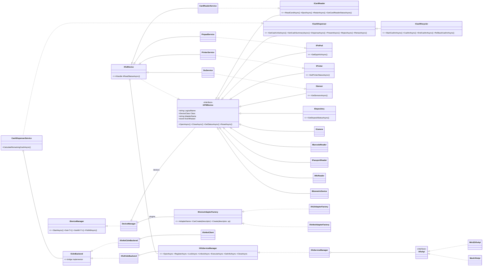

# 14 - ATM / XFS integration architecture

Everything here is **implemented** in `src/Agent/*` and `src/Simulator/*` unless marked **[planned]**. Read section 17 first: the XFS layer is data-driven precisely because vendor SDKs differ, and several constants **must be validated on real hardware** before production.

## 1. Layering

```
ATM Agent (workers, health, EJ, commands)                 AtmNexus.Agent.Core
   |
Device Manager  (plugin host, one IDeviceAdapterFactory per technology)
   |
Device services  CardReaderService | CashDispenserService | PrinterService | PinpadService | SiuService      AtmNexus.Devices.Xfs
   |                                   (Bridge)
   |-- Xfs3 transport  -> XfsServiceManager -> IXfsApi -> Win32XfsApi (msxfs.dll)   | MockXfsApi (simulator)
   |-- XFS4IoT transport -> Xfs4IotClient (WebSocket, JSON)                          | MockXfs4IotServer
   |
Vendor Service Provider (NCR / Diebold Nixdorf-Wincor / Hyosung / GRG / Hitachi / KAL SP)
   |
Physical device
```



**Requirements met**: vendor-neutral (consumers see only interfaces + canonical `DeviceStatus.Attributes`), DI (everything constructor-injected; `AddNexusAgentCore`), plugin-based (`IDeviceAdapterFactory`, first factory whose `CanCreate` is true), supports XFS 3.x and XFS4IoT (section 14).

### Adding a device/adapter (plugin recipe)
1. Implement `IATMDevice` (or a specific interface) - e.g. `NcrNativeCardReader : ICardReader` calling a vendor DLL.
2. Implement `IDeviceAdapterFactory` (`AdapterName="ncr-native"`, `CanCreate` on `descriptor.Adapter`), register: `services.AddSingleton<IDeviceAdapterFactory, NcrNativeFactory>()`.
3. Configure `DeviceManager:Devices:[n]:Adapter = "ncr-native"`. No other code changes: pollers, reconciler, health, EJ, commands consume only the interfaces.
4. Emit canonical attributes (`DeviceAttributes.*`) from `GetStatusAsync` so reconciliation/health/twin work unchanged.

## 2. Supported devices

| # | Device | XFS class | Interface | Status fields monitored | Key events | In MVP |
|---|---|---|---|---|---|---|
| 1 | Card reader | IDC | `ICardReader` | `fwDevice, fwMedia, fwRetainBin, usCards` | MEDIAINSERTED, MEDIAREMOVED, CARDRETAINED, RETAINBINTHRESHOLD | **yes** |
| 2 | Cash dispenser | CDM | `ICashDispenser` | `fwDevice, fwSafeDoor, fwDispenser`, cash units (type/count/min/max/status) | CASHUNITTHRESHOLD, SAFEDOOROPEN/CLOSED, CASHUNITERROR, ITEMSTAKEN | **yes** |
| 3 | Depository | DEP | `IDepository` | device, envelope/bin status | threshold events | monitoring stub; **[planned]** adapter |
| 4 | Cash recycler | CRM (CIM+CDM) | `ICashRecycler` : `ICashDispenser` | as CDM + cash-in units | CASHUNITTHRESHOLD, cash-in events | cash-unit monitoring via CDM adapter (type `Recycle`); cash-in ops **[planned]** |
| 5 | Receipt printer | PTR | `IPrinter` | `fwDevice, fwMedia, fwPaper[], fwToner` | PAPERTHRESHOLD, NOMEDIA | **yes** |
| 6 | PIN pad / EPP | PIN | `IPinPad` | `fwDevice, fwEncStat` (**status only; PIN entry never handled**) | tamper/fraud system events | **yes** |
| 7 | Sensors | SIU | `ISensor` | doors, tamper, seismic, heat | PORT_STATUS | **yes** |
| 8 | Camera | CAM | `ICamera` (marker) | device | - | status only **[planned]** |
| 9 | Barcode reader | BCR | `IBarcodeReader` | device | - | status only **[planned]** |
| 10 | Passport reader | CAM/IDC variant | `IPassportReader` | device | - | status only **[planned]** |
| 11 | NFC reader | IDC contactless | `INfcReader` (+ `ICardReader`) | device, media | - | via IDC adapter |
| 12 | Biometric | BIO | `IBiometricDevice` (marker) | device | - | status only **[planned]** |

**Vendor-neutral status vocabulary** (`DeviceAttributes`): `media`, `retainBin`, `safeDoor`, `dispenser`, `paper`, `toner`, `encryptor`, `cabinetDoor`, `tamper`, `vibration`, `heat`. Adapters translate vendor values into this; everything above (reconciler, health, twin) only knows the vocabulary.

## 3. ATM agent device monitoring (workers)

| Worker | Responsibility | Cadence / trigger |
|---|---|---|
| `DevicePollerService` | `DeviceManager.PollAllAsync` -> per-device `DeviceStatus`; cash units from every `ICashDispenser`; `StatusReconciler` turns deltas into events; updates `AgentStateStore` | every 30 s (`Agent:DevicePollInterval`) |
| `XfsEventListener` | single subscription to `IXfsServiceManager.EventReceived`; **only enqueues** (pump thread must stay free); worker thread runs `XfsEventProcessor` -> `IDeviceEventBus` | per XFS message |
| `AlarmProcessor` -> `AlarmPipeline` | de-dup (5 min), flap detection, state latch (safe door, tamper), persist to outbox, wake uploader for Major+ | per event |
| `DeviceHealthService` | `HealthScoreEngine.Calculate(state.Snapshot())`; emits `HEALTH_LEVEL_CHANGED` on level change | every 60 s |
| `HealthScoreEngine` | pure scoring (section 12) | - |
| `ServiceMonitorWorker` | Windows services + processes + network probe; guarded auto-restart (max N/h, idle only); feeds `ApplicationStatus`/`NetworkStatus` | every 45 s |
| `WindowsEventWorker` | Error/Critical events from System/Application via bookmarked `EventLogReader` | every 60 s |
| `InventoryWorker` | software (registry) + patches (WMI), patch compliance flag | daily |
| `EJCollector`, `ProBase*` | sections 9, 10 | file-driven |
| `RemoteCommandWorker` | long-poll -> `RemoteCommandDispatcher` | continuous |
| `TelemetryUploader` | drains SQLite outbox; backoff + jitter | 60 s or on Major+ event |

Threading rules (agent must never harm the ATM): XFS pump thread does O(1) work; every XFS call runs on the thread pool with a timeout; per-handle `SemaphoreSlim` serialises calls (one outstanding command per SP); all queues bounded; polling never calls non-idempotent commands.

## 4. XFS Service Manager

`XfsServiceManager` (`IXfsServiceManager`) wraps `IXfsApi` (WFS* functions) with async, per-handle serialisation, retry policy, telemetry.

| Requested | Method | Native call | Notes |
|---|---|---|---|
| Open | `OpenAsync(logicalName, class)` | `WFSOpen` (after one-time `WFSStartUp`) | returns `hService` (USHORT); session registered |
| Register | `RegisterAsync(handle, XfsEventClass)` | `WFSRegister(hService, classes, hWnd)` | hWnd = message-only window of `XfsMessagePump` |
| Lock | `LockAsync(handle, timeout)` | `WFSLock` | used for exclusive operations (exchange); not for status polling |
| Unlock | `UnlockAsync(handle)` | `WFSUnlock` | |
| Execute | `ExecuteAsync(handle, cmd, data, timeout, retryable)` | `WFSExecute` | **retryable=false** for Dispense/Present/Retract/Read card |
| GetInfo | `GetInfoAsync(handle, category, query)` | `WFSGetInfo` | retried (3x, exponential 250 ms) |
| Close | `CloseAsync(handle)` | `WFSClose` | on dispose and on "hung SP" recovery (`DeviceManager` marks closed and re-opens next poll) |

**Events**: XFS posts `WM_USER+9..12` (EXECUTE/SERVICE/USER/SYSTEM) to the registered window. `XfsMessagePump` owns a hidden **message-only window on a dedicated thread**, reads the `WFSRESULT` (`hService`, `hResult`, event id, buffer), parses the payload by catalog (`XfsPayloadKind`), raises `XfsApiEvent`, and **always calls `WFSFreeResult`** on `lParam` (a leak here exhausts the SP).

**Error handling** (`IXfsErrorClassifier`): `0` = success; table-driven overrides per vendor profile (`Xfs:Manager:ErrorOverrides`); unknown negative codes = `Unknown` -> idempotent calls retried, others surfaced as `XfsException(operation, logicalName, hResult)`. Metrics `xfs.calls/errors/duration` by `op`,`device`.

**Important platform facts**: the XFS manager on most ATMs is **32-bit** -> agent published `win-x86`; struct packing is 1-byte; XFS version negotiation (`LowVersion/HighVersion`, 3.00 = `0x0003`, 3.10 = `0x0A03`, 3.30 = `0x1E03`) decides struct layouts - the shipped marshaller (`Cen30Marshaller`) is the **3.0 reference layout** (section 17).

Code: `src/Agent/AtmNexus.Devices.Xfs/XfsServiceManager.cs`, `Native/*`.

## 5. Cash dispenser

`CashDispenserService : ICashDispenser` (Bridge abstraction) over `ICdmBackend` (`Xfs3CdmBackend` | `Xfs4IotCdmBackend`).

| Operation | Implementation | XFS 3.x | XFS4IoT |
|---|---|---|---|
| `GetCashUnitInfo()` | `GetCashUnitsAsync` -> `CashUnit` DTOs | `WFS_INF_CDM_CASH_UNIT_INFO` (203) | `CashManagement.GetCashUnitInfo` |
| `DispenseCash()` | `DispenseAsync(DispenseRequest)` | `WFS_CMD_CDM_DISPENSE` (202) | `CashDispenser.Dispense` |
| `PresentCash()` | `PresentAsync` | `WFS_CMD_CDM_PRESENT` (203) | `CashDispenser.Present` |
| `RejectCash()` | `RejectAsync` | `WFS_CMD_CDM_REJECT` (204) | `CashDispenser.Reject` |
| `RetractCash()` | `RetractAsync` | `WFS_CMD_CDM_RETRACT` (205) | `CashManagement.Retract` |
| `ResetDevice()` | `ResetAsync` (retryable) | `WFS_CMD_CDM_RESET` (215) | `CashManagement.Reset` |
| `CalculateRemainingCash()` | `CalculateRemainingCashAsync(currency)` = sum(count x denomination) over *dispensable* units | - | - |

**DTOs**: `CashUnit(Number, UnitId, Name, Type, Currency, Denomination, InitialCount, Count, RejectCount, Minimum, Maximum, Status, AppLocked)`, `DispenseRequest(Currency, Amount, MixNumber, Present, TellerId)`, `DispenseResult(Success, DispensedAmount, Notes[], Error)`, `CashSummary`.

**Safety design** (this is the single most dangerous function an ATM exposes):
* Dispensing from the platform is **a diagnostic capability, off by default** (`AllowDispense=false`, `MaxDispenseAmount=100`), enabled per ATM only in signed config for post-maintenance test-note dispense. Remote commands do **not** include a dispense command.
* **Pre-check** `CashCalculator.CanDispense` (bounded-coin reachability, O(units x amount/gcd)) before touching the device: impossible amounts never reach the SP.
* **Never retried** (`retryable:false`): after an exception the notes may have physically moved. The service **reconciles from counters** (before/after `GetCashUnits`) and returns the real dispensed notes - robust against SPs that omit the denomination result.
* Errors are surfaced as `DispenseResult.Error` / `XfsException`, logged with `LogicalName`, amount, currency (never card data).

**Dispensable unit** = type Dispense/Recycle, not app-locked, count>0, status not in {Empty, Inoperative, Missing, Manipulated, NoValue, NoReference}. Reject/retract cassettes never count.

## 6. Card reader

`CardReaderService : ICardReader`.

| Function | Implementation |
|---|---|
| `ReadCard` | `WFS_CMD_IDC_READ_RAW_DATA` (107) with flags (Track2 `0x0002`, Track1 `0x0001`, Track3 `0x0004`, Chip `0x0008`); **not retried** |
| Track data retrieval | `Cen30Marshaller.ReadCardData` -> `XfsCardDataItem(source,status,bytes)`; the service extracts **only**: masked PAN (BIN6+last4), service code, Luhn flag, per-track status/length; raw bytes are zeroed (`Array.Clear`) in a `finally` |
| Raw tracks | returned only if `ReturnRawTracks` **and** descriptor `AllowRawTracks=true` **and** PAN BIN is in `TestBins` (diagnostic test cards); wrapped in `SensitiveBytes` (never prints, wipes on dispose) |
| Chip detection | chip data source status OK and ATR present |
| EMV detection | `AtrParser`: ISO 7816-3 structure (TS 3B/3F, T0 Y/K, TA/TB/TC/TD chain, TCK XOR when T!=0) and EMV rule: protocols only T=0/T=1 |
| Technical fallback | service code 2xx/6xx (chip card) **and** chip read requested **and** chip unreadable -> `TechnicalFallbackSuspected` (skimming / damaged-chip indicator -> security rule) |
| Status monitoring | `fwMedia` -> `media` (Present/NotPresent/Jammed/Entering/Latched), `fwRetainBin` -> `retainBin`, `usCards` -> retained count |
| `EjectCard` / `RetainCard` | `WFS_CMD_IDC_EJECT_CARD` (103) / `RETAIN_CARD` (104); not retried |
| Events | MEDIAINSERTED -> `CardInserted`; MEDIAREMOVED -> `CardTaken`; CARDRETAINED -> `CardRetained`(Warning); RETAINBINTHRESHOLD -> `RetainBinHigh`; media `Jammed` (poll) -> `CardJam`(Critical) |

## 7. SIU (sensors) - event-driven

```
XFS SP -- WFS_SRVE_SIU_PORT_STATUS(portType, index, status) --> XfsEventListener --> ServiceEventHandler
        --(SiuSensorMap: (portType,index) -> SensorKind, ActiveMask)--> DeviceEvent
        --> IDeviceEventBus --> AlarmProcessor --> state latch + outbox + immediate upload (Major+)
Poll (30 s): SiuService.GetStatusAsync -> attributes (safeDoor/cabinetDoor/tamper/vibration/heat) -> StatusReconciler (safety net)
```
| Sensor | Event | Severity | Health effect |
|---|---|---|---|
| Safe door open | `SafeDoorOpen` | **Critical** | security component 0 (door latch until `SafeDoorClosed`) |
| Cabinet / vandal shield open | `CabinetDoorOpen` | Major | security 30 |
| Tamper / internal tamper | `TamperDetected` | **Critical** | security 0 + **score cap 40** |
| Vibration / seismic | `VibrationDetected` | Major | history |
| Heat sensor | `TemperatureHigh` | Major | history |
| EPP encryptor `Tampered` | `TamperDetected` | **Critical** | device score 0 |

**Vendor-specific wiring is data**: `SiuSensorMap` (port type/index/active mask). Default (CEN/XFS reference): doors port type 2 (cabinet 0, safe 1, vandal 2), sensors port type 1 (operator switch 0, tamper 1, internal tamper 2, seismic 3, heat 4, proximity 5). Hyosung-style override (vibration at index 6) is demonstrated by the simulator and unit-tested. **Temperature monitoring**: XFS SIU only exposes a heat *threshold* sensor; a numeric temperature needs a vendor extension or Windows thermal/IPMI source - `ITemperatureProbe` is defined for this **[planned]**.

## 8. XFS event processing

Four handlers, one per event class, sharing a data-driven `XfsEventCatalog` (scope, kind, id -> domain event, severity, payload kind) with enrichment in code:

| XFS event class | Handler | Example in -> out |
|---|---|---|
| `WFS_EXECUTE_EVENT` (intermediate, command-bound) | `ExecuteEventHandler` | `WFS_EXEE_IDC_MEDIAINSERTED` -> `CardInserted`(Info); `WFS_EXEE_CDM_CASHUNITERROR` -> `HardwareError`(Major) |
| `WFS_SERVICE_EVENT` (state changes) | `ServiceEventHandler` | `WFS_SRVE_CDM_SAFEDOOROPEN` -> `SafeDoorOpen`(Critical); `WFS_SRVE_SIU_PORT_STATUS(2,1,open)` -> `SafeDoorOpen`; `(1,1,active)` -> `TamperDetected`(Critical) |
| `WFS_USER_EVENT` (operator-actionable) | `UserEventHandler` | `WFS_USRE_CDM_CASHUNITTHRESHOLD` + unit status Low -> `CashLow`(Major), Empty -> `CashEmpty`(Critical); `WFS_USRE_PTR_PAPERTHRESHOLD` Low -> `PaperLow`(Warning), Out -> `PaperEmpty`(Major) |
| `WFS_SYSTEM_EVENT` (manager/SP level) | `SystemEventHandler` | `WFS_SYSE_HARDWARE_ERROR` -> `HardwareError`(Critical); `WFS_SYSE_FRAUD_ATTEMPT` -> `FraudAttempt`(Critical); `WFS_SYSE_DEVICE_STATUS(HWERROR)` -> `DeviceStatusChanged`(Critical) |

Banking scenarios covered by tests (`XfsEventProcessorTests`, `AgentPipelineTests`): cassette 2 low then empty during peak hours; card jam after skimmer fallback reads; receipt paper low at a high-traffic lobby ATM; safe door opened outside CIT window; tamper + vibration during a night-time attack; EPP tamper; hardware error on dispenser.

Domain event -> alert code (`AlarmProcessor.ToCode`): `CashLow`->`CASH_LOW`, `CardJam`->`CARD_JAM`, `PaperEmpty`->`PAPER_EMPTY`, `SafeDoorOpen`->`SAFE_DOOR_OPEN`, `TamperDetected`->`TAMPER_DETECTED`, ...

## 9. Electronic journal (EJ)

```
EJ file(s) -- IEJProvider (list files, read complete lines from checkpoint) --> IEJParser (profile regex, stateful per file)
    --> EjTransaction (masked PAN, type, amount, outcome, error codes, sanitised lines)
    --> EJIndexer (bulk NDJSON, monthly index, deterministic _id) --> IEjSink
          GatewayEjSink (ATM: SQLite outbox -> /api/agent/ej -> Kafka atm.ej.batch)
          ElasticEjSink (server EJ indexer / lab: Elasticsearch _bulk)
    --> EJStorageService: send THEN checkpoint (at-least-once; idempotent ids)
```
| Component | Class | Notes |
|---|---|---|
| `IEJProvider` | `NcrEjProvider`, `DieboldNixdorfEjProvider`, `KalEjProvider`, `GenericEjProvider` (fallback, last) | share `LineFileReader` (FileShare.ReadWrite|Delete, exact byte offsets, complete lines only, handles truncation) |
| `EJParser` | `ProfileEjParser(EjProfile)` | profiles: `EjProfile.Ncr/DieboldNixdorf/Kal/Generic`. **Illustrative dialects** - capture real journals per ATM model/app release and tune the regexes (data, no rebuild) |
| `EJIndexer` | `EJIndexer.BuildBulkBody` | index `atm-ej-YYYY.MM`, `_id` = SHA-256(atm\|file\|startOffset)[0..12] hex |
| `EJStorageService` | `EJStorageService` | checkpoint = **`SafeOffset`** (start of the open transaction), so a restart replays an unfinished transaction instead of splitting it |
| `EJCollector` | `BackgroundService` + `IEjCollectionTrigger` | live offsets tracked in memory separately from durable checkpoints (regression-tested: a transaction spanning two polls is never closed "Incomplete") |

**PCI**: `PanMasker.Sanitize` masks any 13-19 digit run (not only Luhn-valid) to BIN6+last4 and removes magstripe track patterns *before any regex or storage*; `PAN` group values are force-masked; the Elasticsearch template uses `dynamic: strict` so a new unmasked field cannot be indexed silently (`deployment/elastic/atm-ej-template.json`; ILM: hot 30 d -> warm -> cold snapshot -> delete 400 d).

Remote `CollectEj(from,to)` re-reads journals in range ignoring checkpoints (ids are deterministic, so re-sends are idempotent).

## 10. ProBase integration

| Required | Implementation |
|---|---|
| File Watcher Service | `ProBaseFileWatcher`: `FileSystemWatcher` (Changed/Created) + 30 s directory rescan as safety net; incremental reads from checkpoints; handles rotation/truncation; `StartAtEnd` so old history is not replayed as alarms |
| Log Parser Service | `ProBaseLogParser`: configurable regexes (`ProBase:LogLineRegex`, `TransactionRegex`, `OutOfServiceRegex`); PAN-sanitises each line first |
| Health Monitor Service | `ProBaseHealthMonitor`: last-transaction age, errors/hour (sliding window), in/out of service, **idle probe** (`IsIdle`: no open transaction and quiet period) which gates disruptive remote commands (`ProBaseActivityProbe`) |
| Event Publisher | `ProBaseEventPublisher`: `PROBASE_TX_FAILED/TIMEOUT` (Warning), `PROBASE_OUT_OF_SERVICE` (Major), `PROBASE_ERR_<code>` (Major/Critical, per-code severity overrides) via `AlarmPipeline` |
| Process health | `Agent:Processes` / `Agent:Services` handled by `ServiceMonitorWorker` |

Example (default dialect):
```
2025-06-12 10:15:31.123 | INFO  | TxManager | | TX 1001 STARTED
2025-06-12 10:15:35.000 | ERROR | Dispenser | E5001 | Dispense failed: jam
2025-06-12 10:16:00.000 | WARN  | Core      | | ATM is OUT OF SERVICE
```
The log dialect and directories differ per ProBase release/customisation: finalise them in onboarding from real logs (the code is configuration-driven).

## 11. Remote command execution

| Command | Handler | Preconditions | Mechanism |
|---|---|---|---|
| Restart ATM application | `RestartApplicationHandler` | idle (or approved force) | SCM stop/start of `Commands:AtmApplicationService` |
| Restart XFS | `RestartXfsHandler` | idle | restart XFS manager service, then the application (it depends on XFS) |
| Restart device | `RestartDeviceHandler` | idle, device known | `IATMDevice.ResetAsync` (XFS `*_RESET` / XFS4IoT reset) + status |
| Restart Windows service | `RestartWindowsServiceHandler` | idle, **service on allow-list** | SCM |
| Collect logs | `CollectLogsHandler` | `LogDirectories` configured | zip of recent allow-listed files, **PAN-sanitised line by line**, <= 200 MB, upload `PUT /api/agent/logs/{label}` |
| Collect EJ | `CollectEjHandler` | date range <= 31 d | `IEjCollectionTrigger` |
| Run diagnostics | `RunDiagnosticsHandler` | - | poll all devices, network probe, disk, uptime, health -> JSON (<= 8 KB) |
| Reboot ATM | `RebootHandler` | idle + **dual control** | `shutdown.exe /r /t 60 /c ...` (System32, argument list, no shell) |
| Shutdown ATM | `ShutdownHandler` | idle + **dual control** | `shutdown.exe /s /t 60 ...` |

**Verification pipeline** (`RemoteCommandDispatcher`, strict order): 1 signature (ECDSA P-256 over canonical form, pinned `keyId`) -> 2 addressed to this ATM -> 3 freshness (`expiresAt`, skew 2 min) -> 4 local policy (`Enabled` set) + dual control (`ApprovedBy` != `IssuedBy`) -> 5 replay (persistent nonce store) -> 6 handler with timeout (10 min) -> result. Failures return `Rejected`/`Expired` with a reason and are themselves security signals.

## 12. ATM health score engine

`HealthScoreEngine.Calculate(HealthInputs)` is a pure function (same code on the ATM and server-side).

| Component | Weight | Score rule (0-100) |
|---|---|---|
| **Devices** | 30 | class-weighted average (dispenser 3, card reader 3, PIN pad 3, depository 2, printer 1, sensors 1, camera 0.5). Device score: Online/Busy 100, UserError 60, Unknown 50, Offline 30, HW error/PowerOff/NoDevice/Fraud 0; then attribute caps: card `media=jammed` 20, paper jammed 20 / out 40 / low 80, retain bin full 40 / high 80, encryptor tampered 0, dispenser `cuStop` 30 / `cuState` 70 |
| **Cash** | 20 | mean over dispense/recycle units: not dispensable 0, Low or count <= min 40, else 100 |
| **Application** | 15 | app not running 0; XFS manager down 20; else 100 - 40 (out of service) - 30 (no transaction > 6 h) - min(40, 4 x errors/h) |
| **Network** | 10 | unreachable 0; latency >500 ms -30 / >200 ms -10; loss >5% -40 / >1% -15 |
| **Security** | 15 | tamper 0; safe door open 0; cabinet open 30; fraud attempt (1 h) 20; patch non-compliant -20 |
| **History** | 10 | `100 - sum(w x 0.5^(age/6h))` over 24 h alarms; w: Warning 3, Major 8, Critical 20 |

`Score = round(sum(weight x component) / 100)`, then **hard caps**: tamper active -> <= 40; cannot dispense (dispenser down/offline or all dispense units unusable) -> <= 50; cannot accept cards / PIN (card reader or PIN pad down, card jam, EPP tampered) -> <= 50; application or XFS manager down -> <= 30.
**Levels**: Healthy >= 85, Degraded 60-84, Critical 30-59, Down < 30 (`HealthScoreOptions`, all configurable).

Worked example (ATM-000124): card reader `IDC` online but `media=Jammed` (device score 20 -> devices = (3x100 + 3x20 + 3x100 + 100 + 100)/11 = 78), cassette 2 low (cash 70), one Critical alarm 5 min ago (history ~80): raw = 0.30x78 + 0.20x70 + 0.15x100 + 0.10x100 + 0.15x100 + 0.10x80 = **85** (would read Healthy) -> the **card-reader hard cap** (<= 50, no card transaction possible) -> **50, Critical**. This is why caps exist: a weighted average alone hides faults that stop the ATM serving customers.

**Alert thresholds**: level change emits `HEALTH_LEVEL_CHANGED` (Degraded Warning, Critical/Down Critical); server rules (Alert Service): P1 incident when Down > 10 min; Critical for 30 min with no open incident -> auto-incident; fleet rule: >5% of a region Critical simultaneously -> group alert.
**Dashboard API**: `GET /api/dashboard` (fleet tiles + worst 10), `GET /api/atms/{id}/status` (score, 6 component scores, reasons, devices, cash), `GET /api/atms?status=CRITICAL`. Component scores are stored in `atm_status.components` and reported by the agent as `metrics["health.<component>"]`.

## 13. Digital twin

`GET /api/atms/{id}/twin` -> `DigitalTwinBuilder` (pure; unit-tested). Structure:

```
ATM
 +- Card Reader   (IDC30)   state, health, attributes, faults[]
 +- EPP           (PIN)
 +- Deposit Module
 +- Dispenser     (CDM)     + cash units
 +- Sensors       (SIU)
 +- Camera
 +- Printer
```
* **Device state model**: canonical `state` (ONLINE..FRAUD_ATTEMPT) + attributes vocabulary + `lastStateChangeAt`.
* **Health model**: per component `HEALTHY | DEGRADED | FAULTED | OFFLINE` (Offline-family state -> OFFLINE; HW error/fraud or any CRITICAL fault -> FAULTED; any fault or UserError/Unknown -> DEGRADED) plus the ATM-level score/components.
* **Fault model**: `TwinFault{code, severity, description, since}` from (a) state, (b) attribute rules (`media=jammed` -> `CARD_JAM` ...), (c) cash unit rules (`CASH_EMPTY`, `CASH_LOW`, `CASH_UNIT_FAULT`), (d) open alerts matched by `source`/`data.device`, de-duplicated by code, sorted by severity.

```json
{
  "atmId": "dddddddd-dddd-dddd-dddd-dddddddddddd", "atmCode": "ATM-000124", "vendor": "DN", "model": "DN Series 200",
  "healthScore": 38, "healthLevel": "CRITICAL", "connectivity": "ONLINE", "lastSeenAt": "2025-06-12T10:15:40Z",
  "healthComponents": { "devices": 60, "cash": 40, "application": 100, "network": 100, "security": 100, "history": 70 },
  "components": [
    { "slot": "Card Reader", "logicalName": "IDC30", "deviceClass": "CARD_READER", "state": "HARDWARE_ERROR", "health": "FAULTED",
      "attributes": { "media": "Jammed" },
      "faults": [ { "code": "HARDWARE_ERROR", "severity": "CRITICAL", "description": "IDC30 reports a hardware error", "since": "2025-06-12T10:10:40Z" },
                  { "code": "CARD_JAM", "severity": "CRITICAL", "description": "Card jammed in reader", "since": "2025-06-12T10:10:40Z" } ] },
    { "slot": "Dispenser", "logicalName": "CashDispenser", "deviceClass": "CASH_DISPENSER", "state": "ONLINE", "health": "DEGRADED",
      "attributes": { "safeDoor": "closed", "dispenser": "ok" },
      "faults": [ { "code": "CASH_LOW", "severity": "MAJOR", "description": "Cash unit 2 (INR 2000) low: 90", "since": null } ],
      "cashUnits": [ { "unitNumber": 2, "currency": "INR", "denomination": 2000, "noteCount": 90, "minimum": 150, "status": "Low" } ] }
  ],
  "faults": [ { "code": "HARDWARE_ERROR", "severity": "CRITICAL" }, { "code": "CARD_JAM", "severity": "CRITICAL" }, { "code": "CASH_LOW", "severity": "MAJOR" } ],
  "generatedAt": "2025-06-12T10:15:42Z"
}
```
Live updates: the portal subscribes to the SignalR group `atm:{code}` and patches the twin from `atm.status.changed`/alert events; a full `GET .../twin` reconciles on reconnect.

## 14. XFS4IoT support - Adapter + Bridge + migration

* **Adapter pattern** (technology level): `IDeviceAdapterFactory` per transport (`Xfs3AdapterFactory`, `Xfs4IotAdapterFactory`); each yields objects implementing the same `ICashDispenser`/`ICardReader`/... interfaces. Consumers never know which technology is underneath.
* **Bridge pattern** (logic level): `CashDispenserService` (abstraction: validation, feasibility, no-retry policy, reconciliation, logging) is decoupled from `ICdmBackend` (implementor: `Xfs3CdmBackend` | `Xfs4IotCdmBackend`). Business rules are written **once**; adding XFS4IoT for the card reader = write `IIdcBackend` implementors the same way (**[planned]**: card reader/printer/SIU currently XFS 3.x only; the pattern is proven on the dispenser and verified by `Xfs4Iot_Backend_BehavesLikeXfs3_ThroughTheBridge`).
* **Event model**: XFS 3.x events arrive via message pump -> `XfsEventListener`; XFS4IoT unsolicited WebSocket events arrive on the backend -> `IATMDevice.EventRaised` -> `DeviceManager` -> the same `IDeviceEventBus`. Downstream is identical.

| Concept | XFS 3.x (CEN) | XFS4IoT |
|---|---|---|
| Transport | in-proc `msxfs.dll`, window messages | WebSocket (TLS, localhost), JSON messages `{header:{type,name,requestId},payload}` |
| Discovery | `HKLM\SOFTWARE\XFS\LOGICAL_SERVICES` | service discovery endpoint / configured `Endpoint` |
| Status | `WFS_INF_*_STATUS` structs | `Common.Status` (+ per-interface sections) |
| Cash units | `WFS_INF_CDM_CASH_UNIT_INFO` | `CashManagement.GetCashUnitInfo` |
| Commands | `WFS_CMD_*` numeric ids | `Interface.Command` names |
| Events | WFS_{EXECUTE,SERVICE,USER,SYSTEM}_EVENT | event messages (`type: event` or `unsolicited`) |
| Bitness | 32-bit DLL (agent x86) | network protocol: agent can be x64 |

**Migration strategy** (per ATM, no big bang):
1. *Co-existence*: agent ships both factories. Default `Adapter=xfs3`.
2. *Detect*: on a vendor software upgrade that enables XFS4IoT, the installer/`RunDiagnostics` probes the endpoint; the Device Service records `xfs_api` capability per ATM.
3. *Shadow*: run the XFS4IoT backend in **read-only** mode (status + cash units) alongside XFS 3.x for 2 weeks; a comparison job diffs states/counters (mismatch rate must be < 0.1%).
4. *Switch*: change `DeviceManager:Devices[n]:Adapter` to `xfs4iot` via a signed configuration package (ring rollout, automatic rollback on health regression).
5. *Retire*: when a vendor profile has no remaining XFS 3.x ATMs, remove the Win32 path for that profile. The **x86 constraint disappears** once only XFS4IoT is used.

Validate against the XFS4IoT release the vendor implements: command names/payload shapes live only in `Xfs4IotCdmBackend` (one file to adapt).

## 15. ATM simulator

`src/Simulator/AtmNexus.Simulator` runs the **real** agent pipeline (same `AddNexusAgentCore`) on any OS; only the hardware/Windows layer is replaced.

| Part | Class | Role |
|---|---|---|
| Mock XFS provider | `MockXfsApi : IXfsApi` | renders `SimulatedAtm` as XFS status/cash-unit payloads, executes commands (greedy dispense, card read with Visa test PAN + valid EMV ATR, eject/retain, resets), raises WFS_* events like an SP |
| Physical model | `SimulatedAtm` | cassettes (20/50/100 + reject), doors, tamper, vibration, paper, EPP, jam, chip failure |
| Scenarios | `ScenarioEngine` | `InsertCard, TakeCard, RetainCard, JamCard, ChipFailure, CashEmpty/Low/Refill, SafeDoor, CabinetDoor, Tamper, Vibration, Paper, EppTamper, HardwareFault, Recover, EjTransaction` - each mutates the model **and** raises the matching XFS event |
| Event generator | `EjGenerator` | writes NCR/DN(Hyosung)/KAL/generic journal dialects, outcomes Completed/Cancelled/Timeout/Failed |
| XFS4IoT | `MockXfs4IotServer` | WebSocket CashDispenser/CashManagement/Common endpoint + push events |
| Fakes | `FakeServiceController`, `FakeProcessRunner`, `FakeNetworkProbe`, `SettableIdleProbe`, ... | Windows-only services |

```
dotnet run --project src/Simulator/AtmNexus.Simulator -- --vendor ncr|dn|hyosung|xfs4iot --atm SIM-0001 --gateway http://localhost:5080
> card | jam | chip-fault on | dispense 170 | empty 3 | low 2 | safe open | tamper on | vibration on | paper out | ej WITHDRAWAL 200 failed | health | status | cash
```
Uses: developer loop, CI end-to-end tests (`AgentPipelineTests`), demos, and the **fleet load test** (N simulator processes x virtual ATMs at 1 msg/min against SIT). `--fleet N` (many virtual ATMs per process) is **[planned]**.

## 16. Code map (requested "code generation" items)

| Requested | Location |
|---|---|
| Device Manager | `src/Agent/AtmNexus.Agent.Core/Devices/DeviceManager.cs` |
| ATM Agent | `src/Agent/AtmNexus.Agent` (host), `AtmNexus.Agent.Core` (workers, `AgentServiceCollectionExtensions`) |
| XFS Wrapper | `src/Agent/AtmNexus.Devices.Xfs/{XfsServiceManager.cs, XfsTypes.cs, Native/*}` |
| Cash Dispenser Service | `Devices.Xfs/Devices/CashDispenserService.cs` |
| Card Reader Service | `Devices.Xfs/Devices/Xfs3Devices.cs` (`CardReaderService`) |
| EJ Service | `Agent.Core/Ej/*` |
| Event Listener | `Agent.Core/Workers/DeviceWorkers.cs` (`XfsEventListener`), `Devices.Xfs/Events/*` |
| Remote Command Handler | `Agent.Core/Commands/*` |
| Services / API | `src/Services/AtmNexus.Services.Device` |
| Tests (xUnit) | `tests/AtmNexus.Tests` (141 test cases: 102 facts + 39 theory rows) |

## 17. Validate on real hardware before production (non-negotiable)

The platform isolates every vendor-sensitive assumption in **data or one file**, but I could not test against physical SPs. Per vendor/model, during certification:

| Item | Where it lives | What to verify |
|---|---|---|
| XFS version & **struct layouts** | `Native/Cen30Marshaller.cs`, `XfsStatusLayouts` | status member order/count, `WFSCDMCASHUNIT` layout for the negotiated version (3.0 reference shipped; 3.10+ appends members); packing |
| **Event IDs** | `XfsEventCatalog.DefaultDefinitions` | numeric ids per `XFS*.H` of the vendor SDK (override via config) |
| **Command / category numbers** | `XfsIds` | CDM/IDC/PTR/PIN/SIU command and info codes vs vendor headers |
| **Error codes** | `Xfs:Manager:ErrorOverrides` | map `WFS_ERR_*` to Transient/DeviceFault/UserError/Fatal |
| SIU wiring | `SiuSensorMap` | port type/index/active mask for each cabinet |
| Logical names | auto-discovery / `DeviceManager:Devices` | actual `LOGICAL_SERVICES` entries |
| EJ & ProBase dialects | `EjProfile`, `ProBaseOptions` regexes | real journal/log samples per application release |
| Dispense marshalling | `Cen30Marshaller.AllocDispense` | only needed if `AllowDispense` is used; vendor-specific denomination structs |
| XFS4IoT messages | `Xfs4IotCdmBackend` | command names/payloads for the vendor's XFS4IoT release |
| Agent impact | perf test on the ATM | CPU/RSS/handles, no interference with transactions during 72 h soak |
